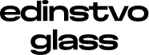

Edinstvo Glass is a simple library for real glass on the web.

At its core is a WebGL lens that bends light through a curved edge, splits colours and frosts what is behind it, the same on macOS and Windows. It comes as one web component with no dependencies.

## Documentation

See the full documentation, with a playground and examples, at [glass.makark.ru/docs](https://glass.makark.ru/docs/).

## npm

To install from npm:

```bash
npm i @edinstvo/glass
```

```html
<script type="module">
  import "@edinstvo/glass/define";
</script>

<edinstvo-glass frost="0.4" refraction="0.5">Hello</edinstvo-glass>
```

## Exports

- `@edinstvo/glass` - `attachGlass`, the element classes, defaults and ranges of every setting.
- `@edinstvo/glass/define` - Registers `edinstvo-glass` and `edinstvo-glass-group`.
- `@edinstvo/glass/glass.css` - Base materials on `backdrop-filter`, for pages without JavaScript or a GPU.

## Contributing

Edinstvo Glass is open source and we appreciate issue reports and pull requests.

### Setting up for development

Initialize the repo:

```bash
git clone https://github.com/EdinstvoAI/edinstvo-glass.git
cd edinstvo-glass
npm ci
```

Run the bench:

```bash
npm run demo
```

Test:

```bash
npm test
```

## License

[MIT](LICENSE)

## Thickness

`thickness` is a normalized material value from `0` to `1` (default `0.5`). It scales the screen-space refraction path, dynamic refraction and channel separation, and adjusts edge highlights. Set it like any other material property:

```html
<edinstvo-glass thickness="0.8" refraction="0.45">Content</edinstvo-glass>
```

A local material layer can override it independently; `inherit` keeps the scene value and `default` restores `0.5`. Thickness is an optical control, not a measurement in millimetres: the renderer uses a 2D signed-distance surface, an approximate normal and a fixed refractive index. It does not simulate a volumetric solid, true bevel mesh or wavelength-specific glass.

## Lighting

Set the light once for the page. Any element can replace one setting and keep the rest.

```js
import { setSceneLight } from "@edinstvo/glass";

setSceneLight({ direction: "top-left", intensity: "80%", color: "white", softness: 0.6 });
```

```html
<edinstvo-glass light-color="blue" reflection="0.6" dynamic-refraction="0.5"></edinstvo-glass>
```

See [Lighting](https://glass.makark.ru/docs/lighting/).
